# Climate, Emissions and Air Quality Analysis

A data analysis project exploring atmospheric CO2 and greenhouse-gas trends, country-level emissions, relationships between emissions and temperature, climate-policy events, air pollution, and data quality. The project uses Jupyter notebooks to analyse data and produces graphs and written findings.

## Project goals

- Analyse long-term atmospheric CO2 and greenhouse-gas trends.
- Compare emissions across countries.
- Investigate relationships between emissions and temperature anomalies.
- Explore changes surrounding major climate policies and historical events.
- Analyse air pollution, including PM2.5 where data is available.
- Evaluate data quality, coverage, assumptions, and limitations.
- Communicate results with graphs and evidence-based summaries.

## How to run

### 1. Install dependencies

Use Python 3.10 or later.

```bash
pip install pandas numpy scipy plotly kaleido reportlab pillow nbformat nbclient ipykernel
```

Kaleido 1.x may require Chrome for graph export. If needed, run:

```bash
plotly_get_chrome
```

### 2. Prepare the data

Open `notebook/00_setup_data.ipynb` and run its cells in order to download/load,
clean, and prepare the source data and CSV tables.

### 3. Run the analysis

Run notebooks `01` through `07` in the `notebook/` directory. Each notebook
should analyse its questions, create graphs, print summaries, and save report
outputs under `reports/parts/`.

### 4. Generate the PDF report (optional)

Build the PDF using outputs already saved by the notebooks:

```bash
python src/make_pdf.py
```

Execute notebooks `01` through `07` first, then build the PDF:

```bash
python src/make_pdf.py --run
```

The PDF output is `reports/Climate_Emissions_Report.pdf`.

### 5. Generate this README

From the project root, run:

```bash
python src/make_readme.py
```

This updates `README.md`, including the project report below. Rerun it after
updating notebook outputs so the embedded report stays current.

## Notebooks

_No notebooks found in `notebook/`._


## Data tables

- `data/tables/aggregates_yearly.csv`
- `data/tables/country_ref.csv`
- `data/tables/country_yearly.csv`
- `data/tables/data_coverage.csv`
- `data/tables/event_countries.csv`
- `data/tables/events.csv`
- `data/tables/global_monthly.csv`
- `data/tables/global_yearly.csv`
- `data/tables/gwp_constants.csv`


# Project Report

The following report is embedded directly in this README. For every topic, it
lists each saved analysis question, its graph image, and its written summary.

_Report generated from 24 saved analysis questions._

## Global Trends

### Q1. How has CO2 changed from 1960 to now?

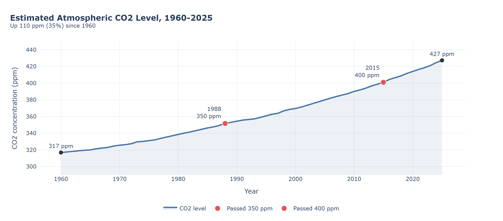

**Summary**

Atmospheric CO2 rose from about 316.9 ppm in 1960 to about 427.4 ppm in 2025, an increase of roughly 110.4 ppm (about 35%). The rise has been continuous: no year shows a decline.

---

### Q2. Is the growth rate of CO2 itself accelerating?

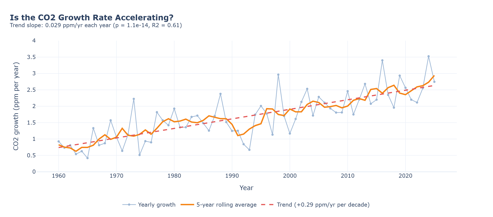

**Summary**

Yes: the average annual growth rate of atmospheric CO2 moved from 0.86 ppm/yr in the 1960s to 2.62 ppm/yr in the 2020s (about 3.0 times higher). A linear trend changes the growth rate by 0.029 ppm/yr every year (about 0.29 ppm/yr per decade, R2 = 0.61). Short-term spikes and dips are mainly driven by El Nino and volcanic events (for example the 1991 Pinatubo eruption) on top of this long-term trend.

---

### Q3. What is the seasonal cycle of CO2 and which month peaks?

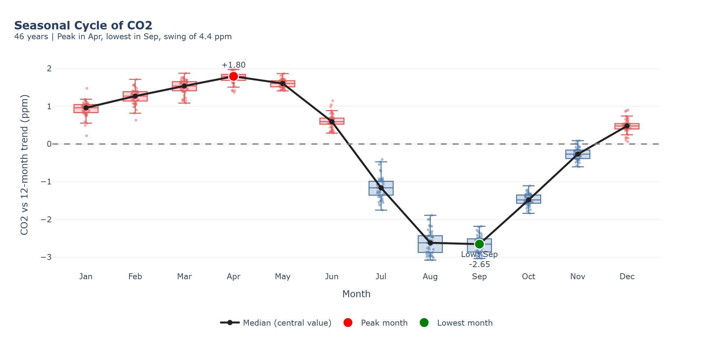

**Summary**

Atmospheric CO2 follows a regular seasonal cycle. After removing the long-term trend with a 12-month moving average, the median across 46 complete years shows CO2 peaking in Apr (+1.80 ppm above trend), with May close behind (+1.61 ppm). It then falls through the summer to its lowest point in Sep (-2.65 ppm), with Aug almost equal (-2.62 ppm). The seasonal swing is about 4.45 ppm from peak to trough. The cycle arises because plants absorb CO2 during the summer growing season and release it through decay in autumn and winter. This swing is small compared with the long-term rise of 110 ppm since 1960.

---

### Q4. How have CH4 and N2O changed, and are they growing faster or slower than CO2 in relative terms?

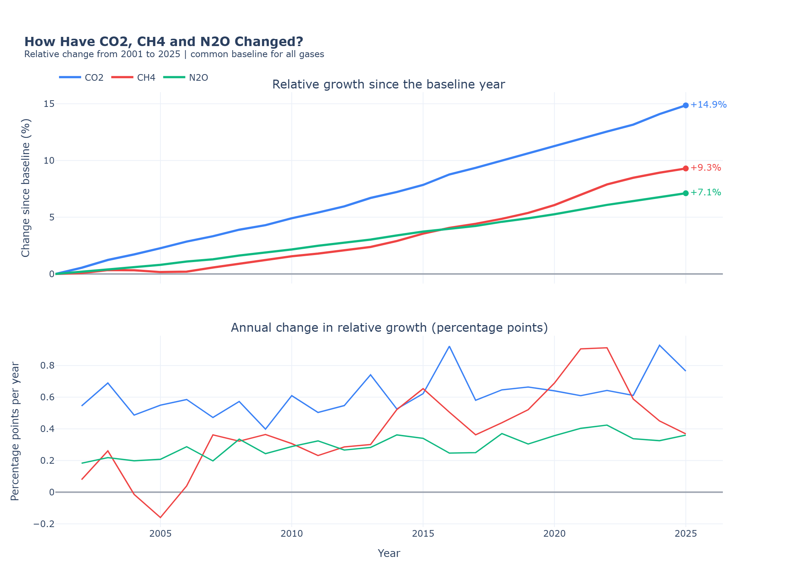

**Summary**

From 2001 to 2025, atmospheric concentrations of all three greenhouse gases increased, and CO2 showed the highest relative growth. CO2 rose 14.86% overall, compared with 9.30% for CH4 and 7.11% for N2O. On an annualized basis, CO2 grew at 0.579% per year, CH4 at 0.371% and N2O at 0.287%. In percentage terms, CH4 accumulated slower than CO2 and N2O accumulated slower than CO2.

---

### Q5. How did global temperature anomaly change by decade, and which decade jumped most?

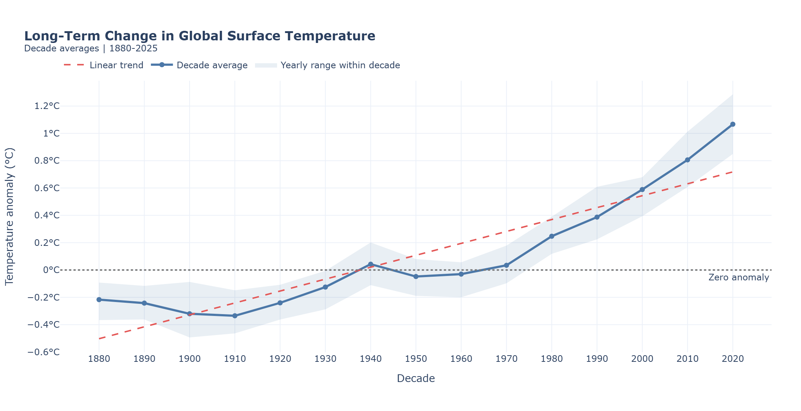

**Summary**

Global temperature anomalies show a clear long-term warming trend, rising from an average of -0.217 °C in the 1880s to +1.067 °C in the 2020s, a difference of 1.284 °C between the two decade averages. The largest increase between consecutive decade averages occurred from the 2010s to the 2020s, rising by 0.261 °C. Note that the 2020s cover only 6 years so far, so that decade is incomplete. The linear trend across decade averages is +0.087 °C per decade.

---

## Gases Warming

### Q1. Which gases contribute most to warming?

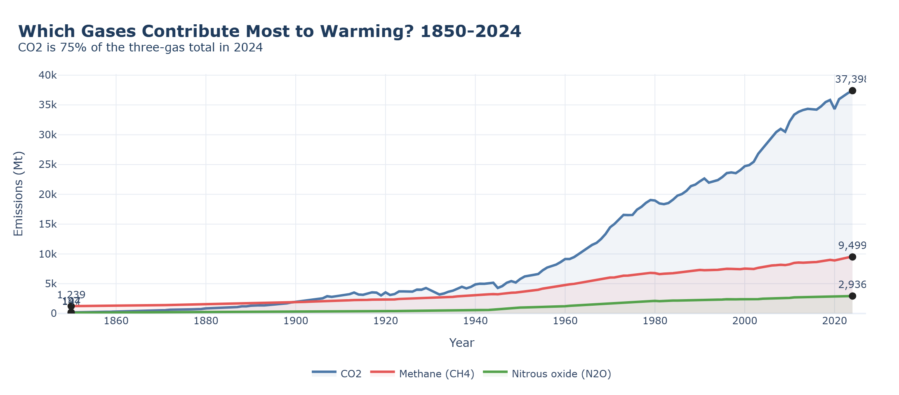

**Summary**

CO2 is the largest contributor to warming. In 2024 it accounts for about 75.0% of the combined three-gas total (CO2, methane and nitrous oxide). Methane (CH4) is second at 19.1%, and Nitrous oxide (N2O) is third at 5.9%. Together, the two non-CO2 gases contribute about 25% of the total, so cutting CO2 matters most, but methane is the second lever. These shares assume the methane and N2O columns are already in CO2-equivalent using the dataset's GWP100 factors.

---

### Q2. How does the picture change if you compare over 20 years instead of 100 years (GWP20 vs GWP100)?

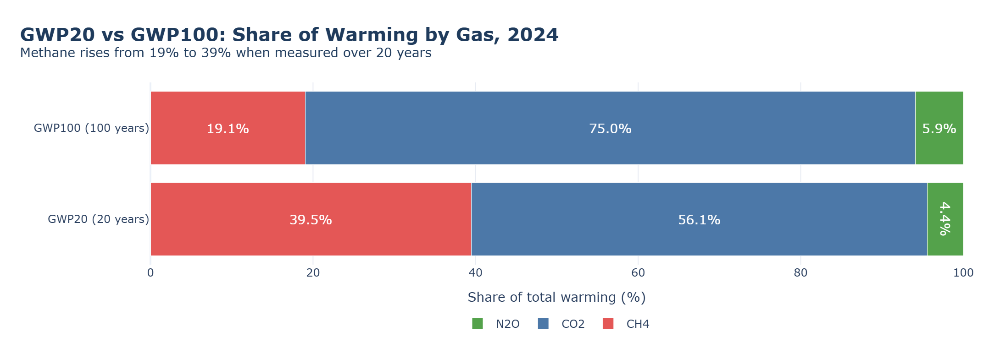

**Summary**

The ranking stays the same (CO2, CH4, N2O), but the gap narrows sharply. Methane has a GWP of 82.5 over 20 years against 29.8 over 100, because it traps heat strongly but breaks down in about a decade. Using 2024 emissions as the baseline, methane's contribution rises from about 19% to 39%, while CO2 falls from 75% to 56%. N2O moves from 5.9% to 4.4%, because the total grows when the short-lived gas is weighted more.

---

### Q3. Which emission sources dominate CO2 gas?

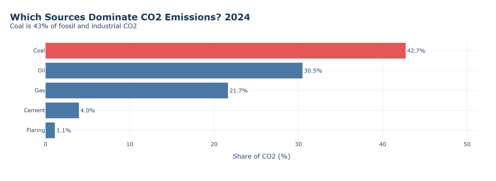

**Summary**

Coal and Oil dominate, together producing about 73% of fossil and industrial CO2 in 2024. Coal is the largest single source at 42.7% (15,800 Mt), compared with 35.6% in 1974. Gas gained the most share over the 50 years (13.7% to 21.7%), while Oil lost the most (46.3% to 30.5%). Cement (4.0%) and Flaring (1.1%) are minor sources. The mix has shifted between fuels, which means power generation and industry as well as transport drive the largest shares of CO2.

---

## Countries Emissions

### Q1. Which countries emit the most today?

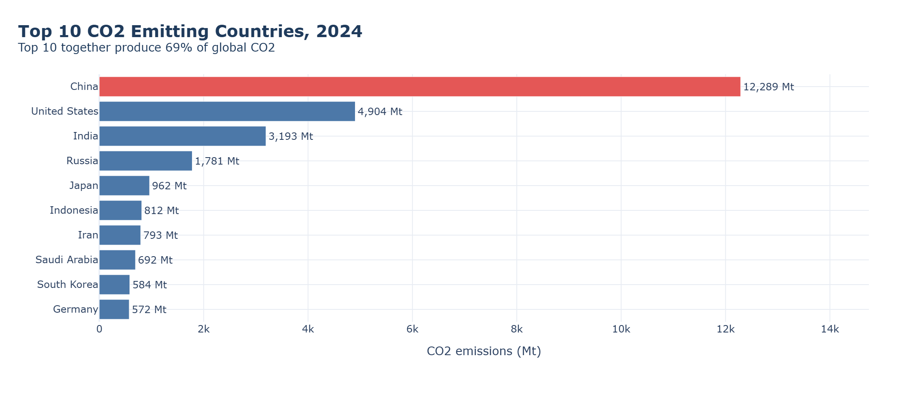

**Summary**

Emissions are highly concentrated. China emits 12,289 Mt, or 31.8% of the global total. United States is second at 4,904 Mt (12.7%) and India third at 3,193 Mt (8.3%). Together these three emit about 53% of world CO2. The top 10 countries produce 68.9%, so action by a small group of countries has an outsized effect on global totals.

---

### Q2. Which countries contributed the most cumulatively since 1850?

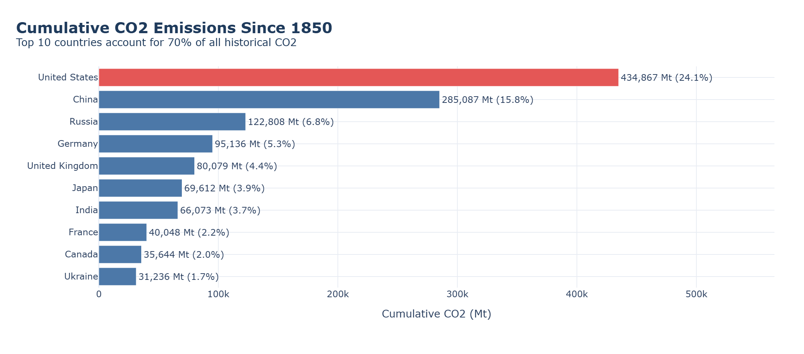

**Summary**

History tells a different story from today. United States leads with 434,867 Mt (24.1% of all historical CO2), ahead of China at 285,087 Mt (15.8%). Russia (6.8%), Germany (5.3%) and United Kingdom (4.4%) follow, which shows the lasting weight of early industrializers. Among today's three largest emitters, China ranks #2 (15.8%), United States ranks #1 (24.1%), India ranks #7 (3.7%) historically. The top 10 account for 69.9% of all cumulative emissions, and United States carries roughly 1.5 times the historical emissions of China.

---

### Q3. Who emits the most per person?

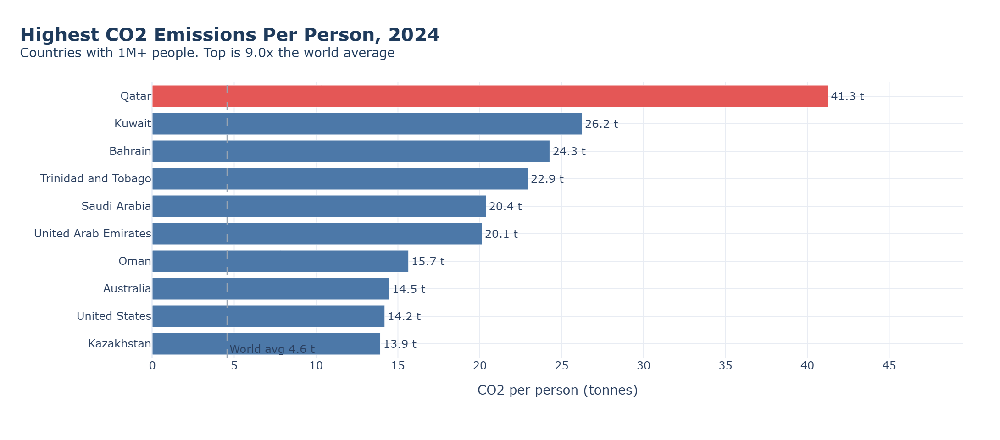

**Summary**

The highest per-person emitters among countries with 1M+ people are Qatar (41.3 t), Kuwait (26.2 t), Bahrain (24.3 t), Trinidad and Tobago (22.9 t), Saudi Arabia (20.4 t), United Arab Emirates (20.1 t). The leader, Qatar, emits 9.0 times the world average of 4.59 tonnes per person. Among the six largest total emitters, per-person levels are: China 8.7 t, United States 14.2 t, India 2.2 t, Russia 12.3 t, Japan 7.8 t, Indonesia 2.9 t. Total and per-person rankings therefore tell very different stories: a country can dominate world totals while its per-person level is moderate, or the reverse.

---

### Q4. Which countries decoupled emissions from GDP growth?

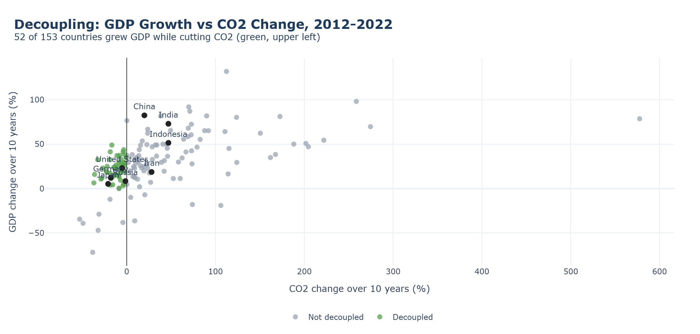

**Summary**

Decoupling is real but not universal: 52 of 153 countries (about 34%) grew GDP while cutting CO2 between 2012 and 2022. Large emitters on the list include United States (GDP +23.1%, CO2 -5.2%), Russia (GDP +8.5%, CO2 -1.4%), Japan (GDP +5.4%, CO2 -20.9%), Germany (GDP +12.3%, CO2 -18.0%), South Korea (GDP +29.7%, CO2 -3.4%). The strongest cuts came from Greece (GDP +6.5%, CO2 -37.0%), United Kingdom (GDP +16.0%, CO2 -36.2%), Estonia (GDP +32.6%, CO2 -32.6%), Finland (GDP +10.8%, CO2 -29.0%). Among the largest emitters that did not decouple are China (GDP +82.5%, CO2 +19.9%), India (GDP +73.1%, CO2 +46.9%), Iran (GDP +18.7%, CO2 +28.0%), Indonesia (GDP +51.6%, CO2 +47.0%). Some decouplers cut emissions only marginally, so a decoupled flag does not always mean meaningful reductions.

---

### Q5. Which regions and income groups changed their share most over 1990 to now?

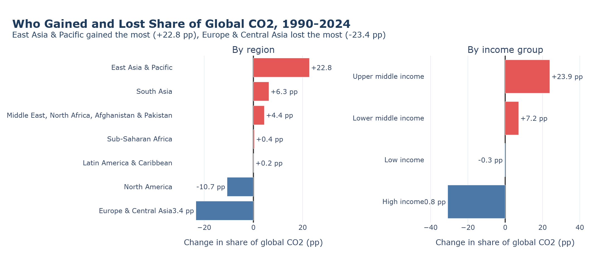

**Summary**

The centre of gravity of global emissions has shifted between 1990 and 2024. By region, the biggest gains were East Asia &amp; Pacific (21.6% to 44.4%, +22.8 pp), South Asia (2.7% to 9.0%, +6.3 pp), Middle East, North Africa, Afghanistan &amp; Pakistan (4.4% to 8.8%, +4.4 pp); the biggest losses were Europe &amp; Central Asia (39.4% to 16.1%, -23.4 pp), North America (25.3% to 14.6%, -10.7 pp). By income group, the gains were Upper middle income (26.5% to 50.4%, +23.9 pp), Lower middle income (5.2% to 12.4%, +7.2 pp), while the losses were High income (67.5% to 36.6%, -30.8 pp), Low income (0.9% to 0.6%, -0.3 pp).

---

## Emissions Temperature

### Q1. How strongly do emissions correlate with temperature?

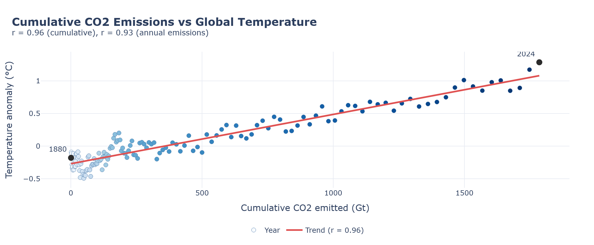

**Summary**

Over 1880-2024, temperature correlates strongly with cumulative emissions (r = 0.96) and also with annual emissions (r = 0.93). Each additional 1,000 Gt of CO2 is associated with about 0.76 °C of warming. Both series trend upward, so correlation alone overstates certainty, but the cumulative relationship matches the physical expectation that warming tracks total CO2 added.

---

### Q2. Does temperature respond with a delay to CO2?

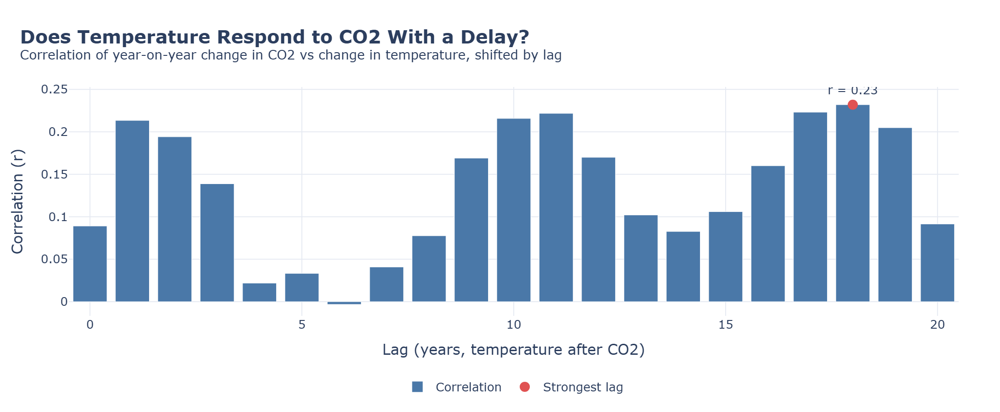

**Summary**

Using smoothed year-to-year changes, the strongest correlation appears at a lag of 18 years (r = 0.23); at zero lag r = 0.09. This suggests temperature lags emissions changes. Annual temperature is noisy (El Nino, volcanoes), so treat the exact lag as indicative rather than precise.

---

## Policy Events

### Q1. What happens to emissions after major energy-policy changes?

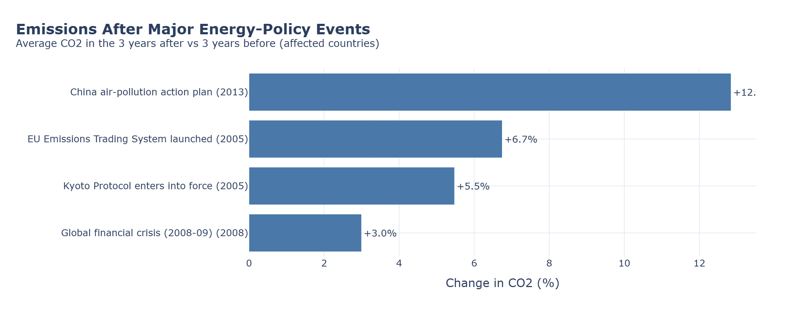

**Summary**

Of 4 events analysed, 0 were followed by lower average emissions in the countries involved. The largest decline followed "Global financial crisis (2008-09)" (2008, 3.0%), while "China air-pollution action plan" (2013) saw a +12.8% change. This is a before/after comparison, not proof of causation, since the wider economy and other policies move at the same time.

---

### Q2. Did the 2020 COVID drop in CO2 show up, how large was it, and how quickly did emissions rebound?

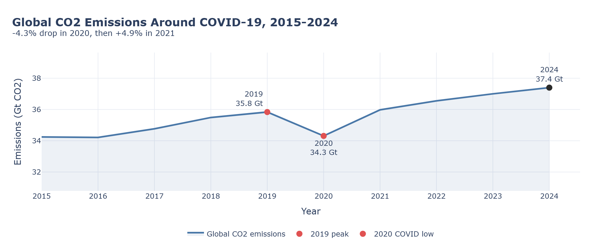

**Summary**

Global CO2 emissions fell from 35.84 Gt in 2019 to 34.31 Gt in 2020, a drop of 1.53 Gt (-4.3%), the sharpest single-year fall in the recent record. Emissions rebounded 4.9% in 2021 and returned to the 2019 level in 2021. The drop was therefore real but temporary: it reflected lockdown-related demand, not structural change.

---

### Q3. Which countries saw the biggest CO2 drop after 2008-09 and recovered fastest?

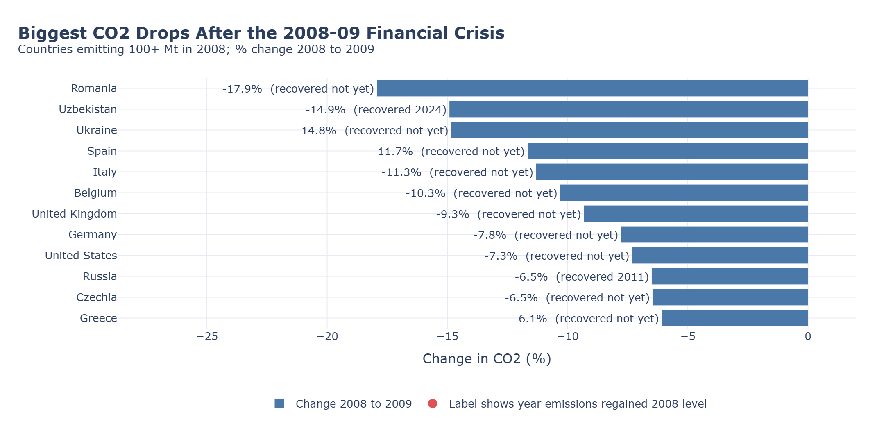

**Summary**

Among large emitters, the steepest falls were Romania (-17.9%), Uzbekistan (-14.9%), Ukraine (-14.8%). The fastest to regain their 2008 emissions were Russia (2011), Uzbekistan (2024). Countries with the deepest drops did not always recover fastest; recovery depended on whether the fall was cyclical (demand) or structural (fuel switching, deindustrialisation).

---

## Air Pollution

### Q1. Which countries have the highest PM2.5 exposure, and how has it changed since 1990?

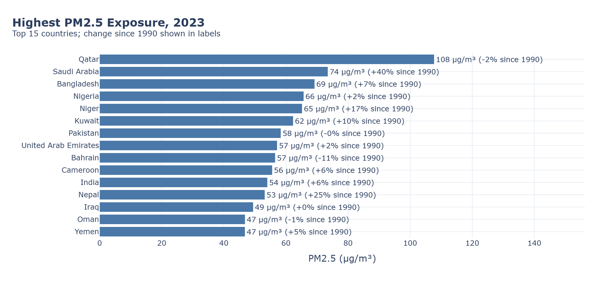

**Summary**

In 2023, the highest PM2.5 exposure was in Qatar (108 µg/m³), Saudi Arabia (74 µg/m³), Bangladesh (69 µg/m³), several times the WHO guideline of 5 µg/m³. Since 1990, 4 of these 15 countries improved while 11 worsened, so high exposure is persistent and not uniformly improving.

---

### Q2. Do countries with higher CO2 per capita have higher PM2.5?

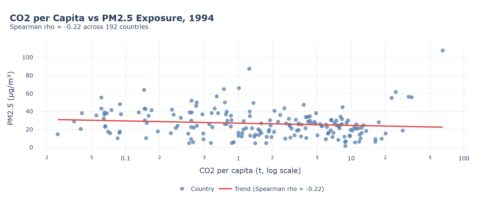

**Summary**

Across 192 countries in 1994, the rank correlation is -0.22, i.e. a weak or negative relationship. High-income, high-CO2 countries often have relatively clean air because of emission controls, while many low-emitting countries face high PM2.5 from solid-fuel cooking, dust and industry. CO2 per capita is therefore a poor predictor of local air quality.

---

### Q3. Where PM2.5 fell sharply, what changed (policy events)?

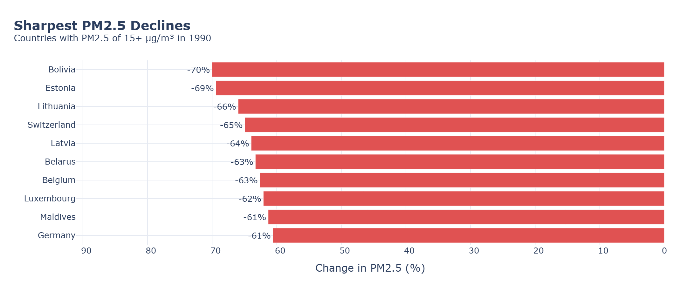

**Summary**

The biggest declines since 1990 were in Bolivia (-70%), Estonia (-69%), Lithuania (-66%). Policy events recorded for these countries: EU Emissions Trading System launched (2005); Global financial crisis (2008-09) (2008); Kyoto Protocol enters into force (2005). Matching an event to a decline shows timing overlap, not proof; check each country's PM2.5 curve around the event year.

---

## Data Quality

### Q1. Which variables have the most missing data and in which years/countries?

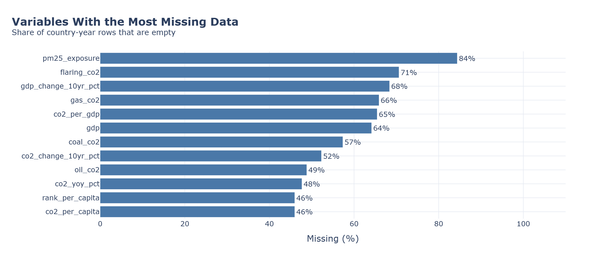

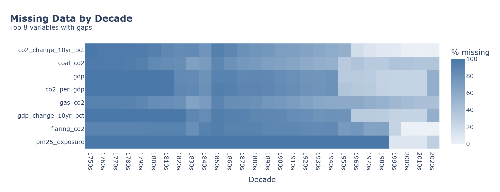

**Summary**

The most incomplete variable is "pm25_exposure" (84% missing), followed by "flaring_co2" (71%) and "gdp_change_10yr_pct" (68%). Gaps concentrate in the earliest decades, and 23 countries have no "pm25_exposure" values at all. Any analysis using these variables is effectively limited to later years and a subset of countries.

---

### Q2. Do the country sums match the world totals?

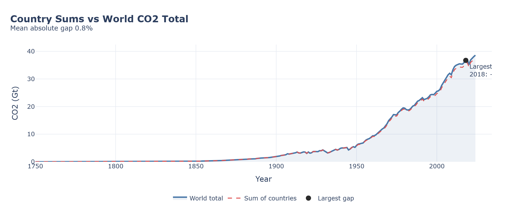

**Summary**

Summing countries gives, on average, a 0.8% difference from the reported world total, with the largest gap in 2018 (-3.4%). In 205 of 275 years the two agree within 2%. Differences typically come from international aviation and shipping, territories without ISO codes, and missing country-years.

---

### Q3. How does the choice of baseline period change the temperature story?

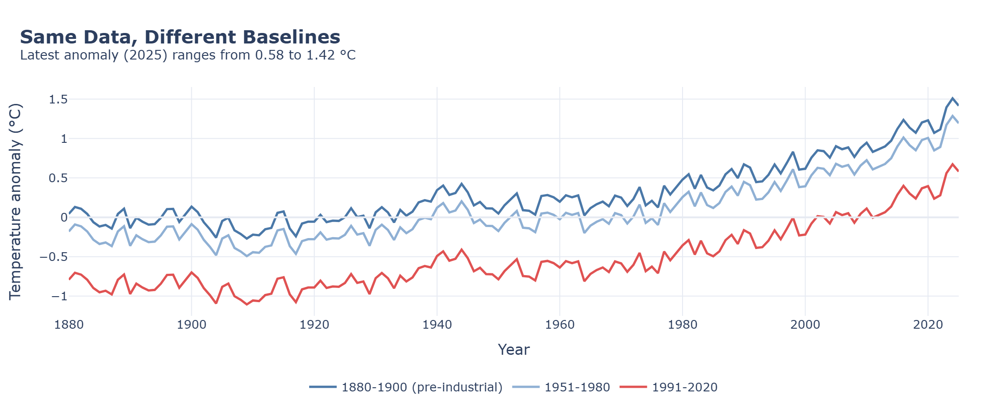

**Summary**

Rebasing the same temperature series changes the headline number: the 2025 anomaly is 1.42 °C vs 1880-1900 (pre-industrial), 1.19 °C vs 1951-1980, 0.58 °C vs 1991-2020. The shape and the warming trend are identical; only the zero line moves. A recent baseline makes warming look smaller and a pre-industrial baseline makes it look larger, so the baseline must always be stated when quoting an anomaly.

---


## Interpretation notes

- Correlation does not by itself establish causation.
- Before-and-after policy comparisons can show associations but do not prove that a policy caused the observed change.
- Temperature anomalies depend on the baseline period; state the baseline when quoting values.
- Check units, missing values, geographic coverage, time coverage, and source definitions before comparing datasets.

---

_Generated by `src/make_readme.py` on 15 October 2026._
